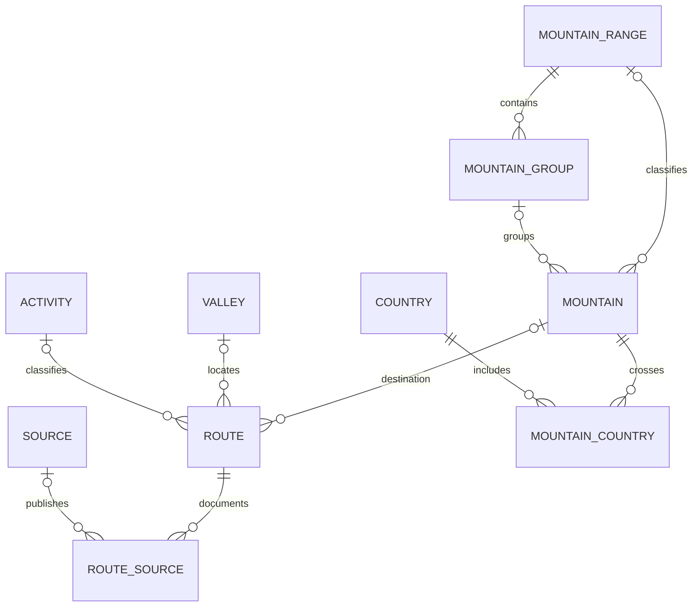

# Share Your Mountain: local database proposal for the React MVP

Analysis date: 25 October 2026. Decision context: a local backend is acceptable, with deployment online later.

## Recommendation

Use **SQLite on the local Node.js backend**, accessed from React through a small HTTP API. Keep the database file outside the frontend's public directory. Use TypeScript and Drizzle for a typed schema and versioned migrations if desired; the driver can be `better-sqlite3`. React should consume DTOs from the API, never import a filesystem database driver.

```text
React application
    │ HTTP requests to /api
    ▼
Node.js API + validation + query layer
    │ prepared statements / typed queries
    ▼
data/shareyourmountain.sqlite
```

This fits the measured data: 12,311 peaks, 3,041 routes and modest supporting tables. SQLite keeps the relational model, joins, constraints and search without requiring MySQL installation or a database service. Data volume alone does not justify a distributed database. This is a recommendation based on the inventory, not a measured application benchmark.

Start with one API process and a single database file. React's development server can proxy `/api` to the local backend. A later deployment can keep the same API and SQLite on a server with a persistent local disk. If the application later requires multiple independently writing server instances, a shared managed database such as PostgreSQL becomes a separate migration. Do not place the SQLite file on a network filesystem or an ephemeral deployment filesystem.

## What was inspected

- All supplied `.sql` files in `C:\GIT\shareyourmountain\Sql`.
- `mcampagn83_symcore.28122017.sql.zip`, reading the SQL member directly in memory; the macOS metadata entry was ignored.
- Table definitions, post-table ALTER statements, INSERT tuples, declared foreign keys, views, procedures, update scripts and aggregate data quality.

The zip contains a 7,883,304-byte SQL dump. It has **37 physical tables, 16 views, 2 procedures and 90,491 inserted rows** in total, including private legacy account/statistics records. Of the 37 tables, 27 contain data and 10 are empty. There are 51 declared foreign keys; the parsed rows contain no missing referenced targets for those declared relationships. This does not validate undeclared relationships or the semantic correctness of the data.

The supplied `Dump.sql` is a schema/routine export, with no INSERT statements. The three dated Script files contain 56, 8 and 42 UPDATE statements respectively, with no CREATE/ALTER TABLE statements. They are data corrections, not schema migrations. Use the December snapshot as the baseline; do not blindly replay older update scripts over it.

Column comparisons account for phpMyAdmin adding AUTO_INCREMENT through ALTER TABLE and ignore explanatory column comments. The meaningful column-definition differences found against the individual schema files are `image_cdn` defaults on the two image tables: the backup uses `b'0'`, while the schema files use NULL. The full schema and aggregate inventory are in `database-inventory.json`.

No source SQL was executed, no database was modified, no private account values were written to the report, and no application source was changed.

## Actual usable catalog

| Data | Rows in December 2017 backup | MVP treatment |
| --- | ---: | --- |
| Mountains | 12,311 | Import; expose 12,266 active records by default |
| Routes | 3,041 | Import; expose 3,028 active records by default |
| Activities | 19 | Preserve IDs and hierarchy; expose activities with results |
| Difficulty definitions | 16 | Preserve the lookup; retain raw route grades too |
| Mountain ranges / groups | 140 / 335 | Preserve hierarchy and membership |
| Valleys | 352 | Preserve; routes need not belong to a mountain |
| Countries / regions / cities | 247 / 4,063 / 39,022 | Small enough to retain; cities can stay out of the initial UI |
| Mountain-country / mountain-region associations | 12,305 / 11,819 | Preserve many-to-many relationships |
| Route source references / source publishers | 3,122 / 37 | Important content and provenance |
| Mountain / route images | 348 / 140 | Preserve references; availability and rights need independent verification |
| DBpedia enrichment | 1,115 | Preserve language, description and source links |
| Parking / GPS-track metadata | 24 / 22 | Preserve; defer complex UI |
| Legacy accounts / wishlists | 43 / 207 | Exclude from public seeds; use a new local development profile |

The route distribution is materially different from the older frontend archive:

| Recorded activity | Routes |
| --- | ---: |
| Trekking | 2,067 |
| Via su Roccia | 678 |
| Via Ferrata | 137 |
| Cascate di Ghiaccio | 90 |
| Ghiaccio e Misto | 59 |
| Sentiero attrezzato | 6 |
| Scialpismo, legacy spelling | 3 |
| Alpinismo / Trekking | 1 |

These are all imported rows, including inactive records. Activity IDs and names differ from the 2015 snapshot: do not reuse the earlier frontend's hardcoded activity assumptions. Derive filter choices from the new database.

## Structure worth preserving



The key migration choice is to preserve the useful relational catalog and simplify the application around it. Do not redesign every entity before the MVP.

Retain the 21 nonempty public catalog/lookup tables: activities, difficulty definitions, mountain-country and mountain-region associations, cities, countries, regions, languages, DBpedia records, mountain images, mountain groups, mountain ranges, mountains, parking, routes, route images, route web references, sources, stone types and GPS-track metadata, plus valleys. This list contains **21 tables** when counted by original names: `act_activity`, `act_difficulty`, `ass_mountaincountry`, `ass_mountainregion`, `geo_city`, `geo_country`, `geo_region`, `language`, `mntn_dbpedia`, `mntn_image`, `mntn_mountaingroup`, `mntn_mountainrange`, `mountain`, `parking`, `route`, `route_image`, `route_webinfo`, `source`, `stone`, `trackgps`, `valley`.

Preserving these small tables is inexpensive and avoids discarding useful catalog data. Not every table needs a screen or endpoint in the MVP. Naming can be modernized consistently during the conversion, while original numeric catalog IDs remain stable.

Defer the empty accommodation, translation, route-detail and route-location tables. Replace ASP.NET identity and legacy profile/role/statistics tables; omit page statistics and the old derived feed/report views from the first application. Keep the original backup unchanged as the migration source.

## Concrete schema adjustments

1. **Keep route-to-mountain optional.** There are 1,301 routes without a mountain link. Keep `mountain_id` nullable and permit independent country, region, valley and area metadata. A route may have its own range/group fields even when no mountain exists.
2. **Keep border geography as junction tables.** Do not collapse mountain country/region to one value. Enforce composite primary keys on the association tables.
3. **Use clear names and units.** Examples: `elevation_m`, `length_m`, `height_m`, `approach_height_m`, `approach_length_m`. `route_height` is described as wall/route elevation difference; do not label it total cumulative ascent without further validation. Retain `route_lengthDescr` alongside numeric length.
4. **Store coordinates as REAL with range checks.** Convert absent, zero-sentinel and out-of-bounds pairs to nullable coordinates in the served model, recording raw values in an import issue log. Do not convert absent coordinates to 0,0. Avoid copying MySQL's FLOAT(M,D) declaration to SQLite.
5. **Retain raw difficulty strings.** Values such as `EE,I,F` combine different grade concepts. Preserve them as `difficulty_raw`; optional parsed grades require a grade-system discriminator. Do not force all grades into one numeric scale or one foreign-key value.
6. **Preserve separate primary and extended activity fields.** The legacy `activityExt_id` is populated on 2,156 routes. Keep it during import; establish its exact UI meaning before using it as a new filter or dropping it.
7. **Keep source links relational.** A route may have multiple reports. Resolve relative report paths with the corresponding source base URL. Two source rows have no base URL; preserve their source text and flag unresolved links instead of inventing a domain.
8. **Treat names as display text, not identity.** There are 108 additional repeated nonempty route-title occurrences and 190 blank route titles. Use stable IDs; fall back to `route_name` for display. Do not deduplicate by title alone.
9. **Decode MySQL booleans explicitly.** Convert BIT literals to integer 0/1, with CHECK constraints, rather than treating nonempty strings such as `b'0'` as truthy.
10. **Keep historical timestamps and source provenance.** MySQL timestamps/datetimes and missing or zero dates need explicit rules. Do not assume a timezone for naive datetime values. Attach an import-batch ID and the snapshot date.

## Personal adventures for the first MVP

Add a new local development profile and an `adventures` table. This profile is a single-user development convenience, not production authentication.

Suggested columns: `id` (UUID), `profile_id`, nullable `mountain_id`, nullable `route_id`, `status` (`planned` or `completed`), nullable `completed_at`, `notes`, `created_at`, `updated_at`.

Use exactly one target per new adventure: a route or a mountain. Derive a route's parent mountain from the route record. Enforce that target rule with a CHECK constraint and prevent duplicate saved targets with partial unique indexes on `(profile_id, route_id)` and `(profile_id, mountain_id)`.

The old wishlist needs a mapping rule if a private account migration is later authorized: 92 rows reference a mountain, 8 a route, and 107 both a mountain and route. Those combined rows may encode legitimate route-plus-mountain context; they are not automatically corrupt. Prefer route as the saved target when present, preserving the historical context in a restricted migration audit.

Do not seed the 43 historical account records or 207 historical wishlists into the distributed MVP database. Create new profiles and saves. Also remove author `user_id` fields from public catalog DTOs/seeds or map them through an explicitly approved public attribution process. Credentials, email addresses and legacy authorization structures do not belong in the React bundle.

## Search and API

Start with endpoints shaped around product tasks:

```text
GET    /api/mountains?q=&countryId=&regionId=&rangeId=&minElevation=&page=
GET    /api/mountains/:id
GET    /api/routes?q=&activityId=&regionId=&mountainId=&page=
GET    /api/routes/:id
GET    /api/filters
GET    /api/map/mountains?bbox=&minElevation=
GET    /api/me/adventures
POST   /api/me/adventures
PATCH  /api/me/adventures/:id
DELETE /api/me/adventures/:id
```

Keep stable response objects and query functions between React and the database. Paginate on the backend. Use indexes for foreign keys and frequent filter combinations; validate actual query plans before adding many combinations. An SQLite FTS5 search index over names, aliases and location text is suitable for name/prefix search. Configure Unicode/diacritic behavior intentionally and normalize user search terms. Arbitrary substring matching needs a separate choice (such as FTS5 trigram search), not an assumption that default FTS is equivalent to the earlier frontend's `includes()` behavior.

Replace the old ranking and nearest-mountain procedures with explicit application queries. Keep geographic search modest: a bounding-box filter over valid mountain coordinates is sufficient initially. If a radius is needed, calculate distance after bounding-box selection. No spatial extension is required for this initial proposal.

## Data gaps that affect visible MVP behavior

- **Route coordinates:** all 3,041 routes lack `route_lat`/`route_lng`; `route_location` is also empty. Mountain coordinates must not be presented as route starts. Existing track metadata provides links, not a verified geometry dataset. Some linked parking locations may help, but are distinct locations.
- **Mountain coordinates:** 11,820 pairs pass the basic nonzero/range test. The remainder includes 230 missing pairs, 260 zero-sentinel records and 1 out-of-range pair. Basic validity does not establish geographic accuracy.
- **Measurements:** 2,517 routes have a zero stored length and 2,712 have no height value. Zero length should be treated as unknown in the UI, with the original value preserved for audit. Do not fabricate distance, elevation gain or walking time.
- **Status:** 45 mountains and 13 routes are inactive. Preserve all rows for audit, but filter active records for normal discovery.
- **Descriptions:** `route_detail` contains no content; much route documentation remains in 3,122 external source references. The MVP is an explorer/aggregator, not a complete offline guidebook.

## Import and delivery plan

1. Preserve and hash the original December zip. Treat it as the canonical source for this import batch.
2. Create versioned SQLite schema migrations. Apply foreign-key enforcement on every connection; use WAL mode and a busy timeout for the single-host backend.
3. Parse and transform allowlisted public records, loading parents before children in a transaction. Preserve original IDs and record field transformations. Do not execute the MySQL dump against SQLite or mechanically replay DEFINER/procedure/view statements.
4. Retain descriptive/source/media/track metadata and explicitly mark inactive and incomplete records. Normalize unknown measurements for display without destroying source provenance.
5. Create a new local development profile; leave private identity, history and statistics out of the seed.
6. Reconcile total and active counts, foreign-key references, unique IDs, boolean decoding, accents, source URLs and source-to-target mappings. Add targeted query/API tests for the observed data gaps. Run SQLite integrity and foreign-key checks.
7. Generate search indexes, implement the discovery/detail/filter/save endpoints and connect React through its data layer.
8. Keep the database, raw backup and local uploads out of Git and `public/`. Track schema, importer, seed-generation code and a small nonprivate fixture. Use a consistent SQLite backup mechanism for the live file rather than copying an active WAL database's `.sqlite` file alone.

No MySQL service is required for routine MVP use. An isolated MySQL import is an optional validation path if future dumps contain syntax unsupported by the text importer; it is not part of this analysis.

## Alternatives considered

| Option | Fit for this MVP |
| --- | --- |
| SQLite on Node backend | Recommended: local file, real relational constraints, joins, search, straightforward single-server deployment |
| MySQL locally | Highest legacy compatibility, but extra service/setup and little benefit for a new single-instance MVP |
| IndexedDB with Dexie | Good when every visitor needs an independent browser-local/offline database; not the primary shared catalog now that a backend is acceptable |
| SQLite WASM in the browser | Possible, but adds browser persistence, worker and concurrency decisions without solving shared application data |
| Existing JSON/localStorage | Adequate for the first static demo; increasingly awkward for the measured relationships, edits and centrally maintained catalog |

Browser offline support can be added later as a cache. It should not require a second full database/sync architecture in the initial MVP.

## Official references checked

- SQLite appropriate uses: https://www.sqlite.org/whentouse.html
- Drizzle SQLite driver support: https://orm.drizzle.team/docs/sqlite/get-started-sqlite
- SQLite FTS5: https://www.sqlite.org/fts5.html
- SQLite foreign keys: https://www.sqlite.org/foreignkeys.html
- SQLite WAL and single-host constraints: https://www.sqlite.org/wal.html
- SQLite backup API: https://www.sqlite.org/backup.html
- Dexie and React: https://dexie.org/docs/Tutorial/React
- Browser storage persistence: https://developer.mozilla.org/en-US/docs/Web/API/Storage_API/Storage_quotas_and_eviction_criteria
- SQLite WASM persistence tradeoffs: https://sqlite.org/wasm/doc/tip/persistence.md

Implementation versions should be selected and locked when implementation begins. This proposal does not depend on a pre-release ORM package.
